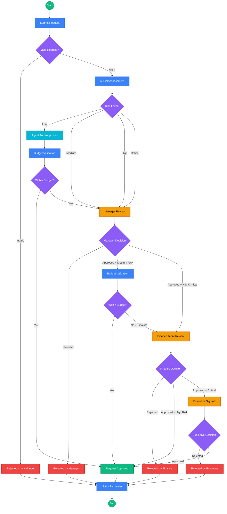

# Assignment 5: Financial Approval System with Human-in-the-Loop

**UCLA Extension — Agentic AI Course**

## Overview

| Part | Focus | Points |
|------|-------|--------|
| **Part 1** | LangGraph Workflow + 3 Interrupts | 35 |
| **Part 2** | Safety Guardrails | 20 |
| **Part 3** | CopilotKit Frontend (GIVEN) | — |
| **Part 4** | LangSmith Tracing + Evaluation | 20 |
| **Part 5** | Three-Layer Evaluation Framework | 50 |
| **Bonus** | Advanced Features | +25 |
| **Total** | | **125 + 25 bonus** |

## What You'll Build

A production-grade Financial Approval System that demonstrates:
- **LangGraph** multi-stage approval workflow with 3 human-in-the-loop interrupt points
- **CopilotKit** frontend for real-time interaction with the approval agent
- **Safety guardrails** for input validation and PII filtering
- **LangSmith** integration for tracing and evaluation
- **RAGAS** framework for industry-standard agent evaluation

## Architecture

```mermaid
flowchart LR
    classDef frontend fill:#3B82F6,color:#fff
    classDef proxy fill:#6366F1,color:#fff
    classDef backend fill:#10B981,color:#fff
    classDef interrupt fill:#F59E0B,color:#000
    classDef reject fill:#EF4444,color:#fff
    classDef db fill:#8B5CF6,color:#fff
    classDef auto fill:#06B6D4,color:#fff

    U((User)) --> Chat[CopilotChat]:::frontend
    U --> Form[RequestForm]:::frontend
    Chat --> Route["/api/copilotkit"]:::proxy
    Form --> Route
    Route --> AGUI["FastAPI + AG-UI"]:::backend
    AGUI --> G1[submit_request]:::backend
    G1 --> G2[assess_risk LLM]:::backend
    G2 -->|Low| BUD[validate_budget]:::auto
    G2 -->|Med/High/Crit| G3["manager_review INTERRUPT"]:::interrupt
    BUD -->|Within budget| G7[process_request]:::backend
    BUD -->|Over budget| G3
    G3 -->|Rejected| REJ[handle_rejection]:::reject
    G3 -->|Med approved| BUD
    G3 -->|High/Crit approved| G5["finance_review INTERRUPT"]:::interrupt
    G5 -->|Rejected| REJ
    G5 -->|High approved| G7
    G5 -->|Crit approved| G6["final_signoff INTERRUPT"]:::interrupt
    G6 -->|Approved| G7
    G6 -->|Rejected| REJ
    G3 -.->|"Pauses graph"| Modal["ApprovalPanel Modal"]:::frontend
    Modal -.->|"resolve(decision)"| G3
    AGUI --> DB[(SQLite Checkpoints)]:::db
```



**Key components:**
- **Blue** = Frontend (Next.js + CopilotKit)
- **Green** = Backend nodes (LangGraph StateGraph)
- **Cyan** = Auto-approve path (low-risk within-budget requests skip human review)
- **Yellow** = Human-in-the-loop interrupt points (graph pauses, modal appears)
- **Red** = Rejection path
- **Purple** = Persistence (SQLite checkpointer for interrupt/resume)

## Business Flow

The approval path escalates based on the AI risk assessment — low-risk requests are auto-approved by the agent, while higher-risk requests require progressively more human reviewers.



**Escalation rules:**

| Risk Level | Approval Path | Human Reviews |
|---|---|---|
| **Low** | Agent auto-approves → budget check → done | 0 (unless over budget → escalates to manager) |
| **Medium** | Manager review → budget check → done | 1 (unless over budget → escalates to finance) |
| **High** | Manager → Finance review → done | 2 |
| **Critical** | Manager → Finance → Executive sign-off | 3 |

## Prerequisites

- Python 3.11+
- Node.js 22 LTS (22.15 or newer: some of the pinned frontend dependencies declare `node >=22.15.0`)
- OpenAI API key (or Google Gemini API key)
- LangSmith API key (for server tracing and `upload_to_langsmith` in Part 5)

## Setup

### 1. Backend

```bash
# Create conda environment
conda create -n hitl-agent python=3.11 -y
conda activate hitl-agent

# Install dependencies
pip install -r backend/requirements.txt

# Configure environment
cp .env.example .env
# Edit .env with your API keys
```

In `.env`, set the key for the provider you use. OpenAI (the default): set `OPENAI_API_KEY`. Gemini: set `LLM_PROVIDER=google` and `GOOGLE_API_KEY` (and `GOOGLE_MODEL` if you want a different model); without `LLM_PROVIDER=google`, `get_llm()` still uses OpenAI and your Gemini key is ignored. Read LLM replies with `response.text`, not `response.content`: Gemini returns `content` as a list of content blocks, and `.text` is a plain string for both providers.

Also replace `LANGSMITH_API_KEY` with your real key, or delete that line: with the placeholder from `.env.example`, the server still works but logs `403 Client Error: Forbidden` errors from LangSmith while requests run, because it tries to send traces with an invalid key.

### 2. Frontend

```bash
cd frontend
npm install

# Configure environment
cp .env.local.example .env.local
```

### 3. Run the Application

You need **two terminals** — one for the backend (Python) and one for the frontend (Node.js).

**Terminal 1: Start the Backend**
```bash
conda activate hitl-agent
python -m backend.server
# Backend starts at http://localhost:8000
# Health check: http://localhost:8000/health
```

**Terminal 2: Start the Frontend**
```bash
cd frontend
npm run dev
# Frontend starts at http://localhost:3000
```

Open **http://localhost:3000** in your browser to interact with the Financial Approval System.

> **Note:** Before you implement your graph, the server automatically loads a **demo graph** (`backend/agent/demo_graph.py`) so you can see the frontend and HITL interrupt flow in action. The demo has all three interrupts and the same routing as the assignment, but it scores risk from the amount alone (no LLM) and skips input validation, so its risk levels can differ from the eval dataset and invalid requests are not rejected. Submit a request of $10,000 or more with the **+ New Approval Request** form and the approval modal appears. Once you implement `create_approval_graph()`, the server switches to your full graph automatically.

### How it Works End-to-End

1. **Submit a request** with the **+ New Approval Request** form on the right sidebar. The form puts the request fields (`title`, `amount`, `department`, ...) into the graph state. A free-text chat message alone does not, so your nodes would see no `amount`.
2. The backend LangGraph workflow processes the request through these stages (which ones run depends on the risk level, see the escalation rules above):
   - **Submit & Validate** → checks amount, department, injection patterns
   - **Risk Assessment** → LLM evaluates risk level (low/medium/high/critical)
   - **Manager Review** (medium/high/critical, or low over budget) → workflow **pauses** (interrupt) → **Approval Panel appears** in browser
   - **Budget Validation** (low/medium only) → checks against department budget limits
   - **Finance Review** (high/critical, or medium over budget) → workflow **pauses** again → **Approval Panel appears** (budget figures appear only when Budget Validation ran; for high and critical requests the panel says the budget was not checked)
   - **Final Sign-off** (critical only) → workflow **pauses** one last time → **Approval Panel shows the decision chain**
   - **Process/Reject** → final result based on all approval decisions
3. At each interrupt, the **Approval Panel modal** pops up showing request details
4. Click **Approve** or **Reject** with comments to resume the workflow
5. The graph continues to the next stage or terminates with rejection

> **Note:** The **Workflow Progress** and **Request History** panels in the sidebar are static placeholders in this starter: they are not connected to the graph state, so they do not change while a request runs. Follow progress in the chat messages and the Approval Panel. Wiring them up is optional and not graded.

## Project Structure

```
.
├── backend/
│   ├── server.py                    # FastAPI + CopilotKit endpoint (GIVEN)
│   ├── config.py                    # Environment & LLM factory (GIVEN)
│   ├── models.py                    # Pydantic schemas (GIVEN)
│   ├── seed_data.py                 # Sample requests (GIVEN)
│   │
│   ├── agent/
│   │   ├── state.py                 # ApprovalState TypedDict (GIVEN)
│   │   ├── graph.py                 # ★ StateGraph assembly (TODO)
│   │   ├── nodes.py                 # ★ 8 nodes + 6 routers (TODO)
│   │   ├── demo_graph.py           # Demo graph for testing (GIVEN)
│   │   └── checkpointer.py         # SQLite checkpointer (GIVEN)
│   │
│   ├── guardrails/
│   │   ├── input_validator.py       # ★ Input validation (TODO)
│   │   └── output_filter.py        # ★ PII filtering (TODO)
│   │
│   └── evaluation/
│       ├── dataset.py               # 12 eval test cases (GIVEN)
│       ├── evaluators.py            # ★ LangSmith evaluators (TODO)
│       ├── run_eval.py              # Evaluation runner (GIVEN)
│       ├── three_layer_evaluators.py # ★ RAGAS 3-layer evaluators (TODO)
│       ├── dataset_generator.py     # ★ LLM dataset generation (TODO)
│       └── run_three_layer_eval.py  # Three-layer eval runner (GIVEN)
│
├── frontend/
│   └── src/
│       ├── app/
│       │   ├── layout.tsx           # CopilotKit provider (GIVEN)
│       │   ├── page.tsx             # Main page with CopilotChat (GIVEN)
│       │   └── api/copilotkit/
│       │       └── route.ts         # API route (GIVEN)
│       │
│       └── components/
│           ├── ApprovalPanel.tsx     # Interrupt approval UI (GIVEN)
│           ├── RequestForm.tsx       # Request form (GIVEN)
│           ├── WorkflowStatus.tsx    # Step indicator (GIVEN)
│           └── RequestHistory.tsx    # Past requests (GIVEN)
│
└── tests/                           # Test harnesses (GIVEN)
```

**★ = Files you need to implement** (7 files total)

## Part 1: LangGraph Workflow + Interrupts (35 points)

### Files to Implement
- `backend/agent/nodes.py` — 8 node functions + 6 routing functions
- `backend/agent/graph.py` — StateGraph assembly

### Workflow Graph

```
START → submit_request ─┬─ invalid ─────────────────────────────────→ handle_rejection → END
                        └─ valid → assess_risk ─┬─ low ────────────→ validate_budget
                                                └─ medium/high/crit → manager_review (INTERRUPT)

manager_review  ─┬─ rejected ──────────────→ handle_rejection
                 ├─ approved + low ────────→ process_request      (low only gets here when over budget)
                 ├─ approved + medium ─────→ validate_budget
                 └─ approved + high/crit ──→ finance_review (INTERRUPT)
validate_budget ─┬─ within budget ─────────→ process_request
                 ├─ over + low ────────────→ manager_review
                 └─ over + medium ─────────→ finance_review
finance_review  ─┬─ rejected ──────────────→ handle_rejection
                 ├─ approved + critical ───→ final_signoff (INTERRUPT)
                 └─ approved + other ──────→ process_request
final_signoff   ─┬─ approved ──────────────→ process_request → END
                 └─ rejected ──────────────→ handle_rejection → END
```

### Key Concepts
- **interrupt()**: Pauses the graph and sends data to the frontend for human review
- **Command(resume=...)**: Frontend sends the human's decision back to resume the graph
- **AsyncSqliteSaver**: `server.py` creates it and passes it to `create_approval_graph(checkpointer=...)`; it persists graph state so interrupted workflows survive server restarts (use the sync `SqliteSaver` from `create_checkpointer()` only in sync scripts)
- **Conditional edges**: Route the workflow based on approval/rejection decisions

### Point Breakdown
| Function | Points | Description |
|----------|--------|-------------|
| `submit_request` | 3 | Validate and submit the request |
| `assess_risk` | 3 | LLM-based risk assessment |
| `manager_review` | 3 | Manager interrupt + decision handling |
| `validate_budget` | 1 | Department budget check |
| `finance_review` | 3 | Finance team interrupt |
| `final_signoff` | 3 | Executive interrupt |
| `process_request` | 1 | Process approved request |
| `handle_rejection` | 2 | Handle rejected request |
| 6 routing functions | 1 each | Conditional routing |
| `create_approval_graph` | 10 | Wire everything together |

## Part 2: Safety Guardrails (20 points)

### Files to Implement
- `backend/guardrails/input_validator.py` — Input validation (10 points)
- `backend/guardrails/output_filter.py` — Output filtering (10 points)

### Input Validation
- Reject negative amounts and amounts exceeding budget ceiling
- Reject invalid departments
- Block SQL injection and XSS patterns
- Enforce the title length limit (`MAX_TITLE_LENGTH`)

### Output Filtering
- Mask SSN patterns (XXX-XX-XXXX)
- Mask credit card numbers
- Redact email addresses
- Mask phone numbers
- Mask financial details (dollar amounts, account numbers)

## Part 3: CopilotKit Frontend (GIVEN)

The frontend is fully implemented for you. Study the code to understand how CopilotKit integrates with LangGraph for human-in-the-loop approvals.

### Key Files
| File | Purpose |
|------|---------|
| `frontend/src/app/layout.tsx` | Wraps the app in `<CopilotKit>` provider pointing to the backend |
| `frontend/src/app/page.tsx` | Two-column layout: CopilotChat (left) + sidebar controls (right) |
| `frontend/src/components/ApprovalPanel.tsx` | Modal overlay for HITL approval using `useLangGraphInterrupt` |
| `frontend/src/components/RequestForm.tsx` | Form that sends the request fields as agent state (`useCoAgent`) plus a chat message |
| `frontend/src/components/WorkflowStatus.tsx` | Visual step-by-step progress indicator |
| `frontend/src/components/RequestHistory.tsx` | List of past approval requests |
| `frontend/src/app/api/copilotkit/route.ts` | API route proxy using `LangGraphHttpAgent` |

`page.tsx` renders `WorkflowStatus` and `RequestHistory` without props, so both stay in their empty state. Wiring them to the agent state is optional.

### How HITL Approvals Work (Frontend ↔ Backend)

```
Backend (LangGraph)                    Frontend (CopilotKit)
──────────────────                    ─────────────────────
manager_review node
  │
  ├─ interrupt({type, title,          useLangGraphInterrupt({ render })
  │    amount, risk_level, ...})  ──► render callback fires with event & resolve
  │                                   ApprovalModal appears (fixed overlay)
  │                                   User sees request details
  │                                   User clicks Approve/Reject
  │                                        │
  ◄─ Command(resume={approved,        resolve(JSON.stringify({approved,
  │    comments})                       comments})) sends decision back
  │
  ├─ Resumes execution with
  │   human's decision
  ▼
validate_budget node (continues)      Modal closes, chat updates
```

### Key Concepts
- **CopilotChat**: Chat interface connecting to the LangGraph agent via CopilotKit
- **useLangGraphInterrupt**: React hook that registers a `render` callback — when the graph calls `interrupt()`, the callback receives the event data and a `resolve()` function
- **resolve()**: Sends the human's decision as a JSON string (`JSON.stringify({approved, comments})`) back to the LangGraph workflow to resume execution
- **SQLite checkpointer** (`AsyncSqliteSaver` in `server.py`, because AG-UI calls the async graph API): Persists the paused graph state so the workflow survives page refreshes

### Testing the Frontend
```bash
cd frontend
npm install          # Install dependencies (first time only)
npm run dev          # Start dev server at http://localhost:3000
```

The frontend needs the backend running (`python -m backend.server`) to function. Without the backend, you'll see the UI layout but chat won't work.

## Part 4: LangSmith Tracing + Evaluation (20 points)

### Files to Implement
- `backend/evaluation/evaluators.py` — Custom evaluators (20 points)

### Evaluators
1. **Risk Accuracy Evaluator** (10 points): Compares predicted risk level to expected
   - Exact match → score 1.0
   - Adjacent level → score 0.5
   - Non-adjacent → score 0.0

2. **Approval Consistency Evaluator** (10 points): Checks if approval status matches expected
   - Match → score 1.0
   - Mismatch → score 0.0

### Tracing
With a real `LANGSMITH_API_KEY` in `.env`, the server (`python -m backend.server`) sends a trace of every workflow run, including the `assess_risk` LLM call and each interrupt, to the LangSmith project named by `LANGSMITH_PROJECT`. The evaluation runners below send no traces.

### Running Evaluation
```bash
python -m backend.evaluation.run_eval
```

`run_eval` (and `run_three_layer_eval`) score the dataset's expected values against themselves; they do not run your graph. They check your evaluator logic, not your agent. With correct evaluators, `run_eval` prints 1.00 for both averages. In `run_three_layer_eval`, the heuristic evaluators and `tool_call_accuracy` print 1.00, while the three LLM-judged ones (`agent_goal_accuracy`, `topic_adherence`, `hallucination`) depend on the judge model and change a little from run to run. Measured once with `gemini-3.8-flash` on the 12 cases, following the docstring hints: agent_goal_accuracy 1.00, hallucination 1.00, topic_adherence 0.97 (one case at 0.67; single cases ranged from 0.33 to 1.00 over repeated runs), overall 1.00. A score far below that usually means a sample is built differently from the hints: for example, Faithfulness with only the input fields as context scored 0.01.

## Part 5: Three-Layer Evaluation Framework (50 points)

### Files to Implement
- `backend/evaluation/three_layer_evaluators.py` — 10 evaluator factories (34 points)
- `backend/evaluation/dataset_generator.py` — LLM dataset generation + LangSmith upload (16 points)

### Layer 1 — Business Metrics (10 points)
Heuristic evaluators that compare workflow outputs to expected results:

| Evaluator | Points | Logic |
|-----------|--------|-------|
| `create_approval_path_evaluator` | 3 | Compare approval path stages. Exact match → 1.0, same length → 0.5, else 0.0 |
| `create_false_positive_evaluator` | 2 | Detect approved-when-should-reject → 0.0 |
| `create_false_negative_evaluator` | 2 | Detect rejected-when-should-approve → 0.0 |
| `create_human_review_efficiency_evaluator` | 3 | Compare human review count. Exact → 1.0, off-by-1 → 0.5, else 0.0 |

### Layer 2 — Agent Performance (12 points)
RAGAS framework metrics for industry-standard agent evaluation:

| Evaluator | Points | RAGAS Metric |
|-----------|--------|--------------|
| `create_tool_call_accuracy_evaluator` | 5 | `ToolCallAccuracy` — validates correct workflow stages invoked in correct order |
| `create_agent_goal_accuracy_evaluator` | 4 | `AgentGoalAccuracyWithReference` — did agent reach correct final status? |
| `create_topic_adherence_evaluator` | 3 | `TopicAdherenceScore` — agent stays within financial approval domain |

All three are multi-turn RAGAS metrics (`ragas==0.4.3`, imported from `ragas.metrics`): build a `MultiTurnSample` and score it with `multi_turn_ascore()`. They have no `single_turn_ascore()`, and there is no `ragas.metrics.TopicAdherence`. Create LLM-backed metrics inside the evaluator, not in the factory: the tests call every factory, and `get_llm()` raises `Missing credentials` when `OPENAI_API_KEY` is not set at all (a clone without `.env`, or CI). With the placeholder key that `cp .env.example .env` leaves in place, `get_llm()` succeeds and the first LLM call fails with a 401 authentication error. Wrapping the LLM with `LangchainLLMWrapper(get_llm())` prints `LangchainLLMWrapper is deprecated ... Use llm_factory instead`: that warning is expected, keep the wrapper: it wraps whatever `get_llm()` returns (tested with Gemini), while `llm_factory` needs a raw provider client.

### Layer 3 — Safety & Compliance (12 points)
Mixed RAGAS + heuristic evaluators for safety:

| Evaluator | Points | Logic |
|-----------|--------|-------|
| `create_policy_adherence_evaluator` | 4 | Heuristic: over-ceiling must reject, at least the required reviews per risk level (budget escalation can add more) |
| `create_hallucination_evaluator` | 4 | RAGAS `Faithfulness` or LLM judge: no fabricated details (context = request fields plus the workflow record) |
| `create_audit_trail_evaluator` | 4 | Heuristic: one decision per human review stage (manager, finance, final sign-off) with the right keys; an empty list is correct when no review ran |

### Dataset Generator (16 points)

| Function | Points | Description |
|----------|--------|-------------|
| `generate_eval_dataset` | 4 | Use LLM to generate diverse test cases |
| `generate_edge_cases` | 4 | Generate boundary/adversarial scenarios |
| `upload_to_langsmith` | 4 | Upload dataset to LangSmith via `client.create_dataset()` |
| `validate_generated_dataset` | 4 | Validate schema, types, value ranges |

### Running Three-Layer Evaluation
```bash
python -m backend.evaluation.run_three_layer_eval
```

The three LLM-judged evaluators make about 9 LLM calls per test case with the RAGAS options in the hints (2 for agent goal accuracy, 2 for Faithfulness, 2 plus one per extracted topic for topic adherence): a full run over the 12 cases took 103 calls with `gemini-3.8-flash`. Budget for that, and while you debug, run on a slice such as `run_three_layer_evaluation(EVAL_DATASET[:2])`.

## Bonus Features (+25 points)

1. **Parallel Approval Routing** (+8 points): For high-risk requests, run manager and finance reviews simultaneously
2. **Approval Dashboard** (+8 points): Real-time dashboard showing approval pipeline statistics
3. **Audit Trail** (+5 points): Persistent audit log with timestamps, reviewers, and decisions
4. **Notification System** (+4 points): Email/Slack notification simulation when requests need review

## Running Tests

```bash
# Run all tests
python -m pytest tests/ -v

# Run individual test suites
python -m pytest tests/test_graph.py -v      # Part 1
python -m pytest tests/test_guardrails.py -v  # Part 2
python -m pytest tests/test_frontend.py -v    # Part 3
python -m pytest tests/test_evaluation.py -v  # Part 4
python -m pytest tests/test_three_layer_evaluation.py -v  # Part 5
```

## Useful Commands

```bash
# Verify imports
python -c "from backend.agent.state import ApprovalState; print('State OK')"
python -c "from backend.config import get_llm; print('Config OK')"
python -c "from backend.seed_data import SAMPLE_REQUESTS; print(f'{len(SAMPLE_REQUESTS)} requests')"

# Run backend server
python -m backend.server

# Run frontend dev server
cd frontend && npm run dev

# Run evaluation
python -m backend.evaluation.run_eval
python -m backend.evaluation.run_three_layer_eval
```

## Resources

- [LangGraph Human-in-the-Loop](https://langchain-ai.github.io/langgraph/concepts/human_in_the_loop/)
- [LangGraph interrupt() API](https://langchain-ai.github.io/langgraph/reference/types/#langgraph.types.interrupt)
- [CopilotKit Documentation](https://docs.copilotkit.ai/)
- [CopilotKit useLangGraphInterrupt](https://docs.copilotkit.ai/reference/v1/hooks/useLangGraphInterrupt)
- [LangSmith Evaluation](https://docs.smith.langchain.com/evaluation)
- [RAGAS Agent Evaluation](https://docs.ragas.io/en/latest/concepts/metrics/available_metrics/agents/)
- [RAGAS LangGraph Integration](https://docs.ragas.io/en/latest/howtos/integrations/_langgraph_agent_evaluation/)

## Submission

1. **Fork** this repository to your own GitHub account and do your work there. If your repository is private, add **Vyoma** as a collaborator so it can be graded
2. Run the tests and both evaluation runners (see **Running Tests** and **Useful Commands** above)
3. Commit and push your changes to `main`, then check on GitHub that all files are present
4. Submit your repository link on **Canvas** (Assignment 5)

### How Grading Works

- Your score and feedback are posted in **Canvas** (SpeedGrader), on your Assignment 5 submission
- The commit on `main` at the time you submit on Canvas is the one that is graded. Pushes after you submit are not graded unless you resubmit on Canvas
- After you submit, you get **one update**: push your changes and resubmit the link on Canvas, any time until **Nov 4, 11:59 PM PT**. The resubmitted version is regraded with no late penalty, and that grade is final
- The GitHub Actions workflow in this repository is not used for grades. Nothing opens a Pull Request or posts a score on GitHub, so you will not find results in the **Pull Requests** or **Actions** tabs
